# 022 基于 Scrapy 与 Django 的农产品价格监测分析系统-设计展示

> **代码有偿获取 可接受定制 微信联系方式: csbysj2020 或 ACE2487，备注(BS)**

> **完整源码与全套文档 · 在线自助获取 >>> [https://mbd.pub/o/bread/YZaWlZZxaw==](https://mbd.pub/o/bread/YZaWlZZxaw==)**

> **成品页（功能介绍 / 更多选题）>>> [https://bishe.suilang.net/products/agri-price-monitor](https://bishe.suilang.net/products/agri-price-monitor)**

> 

> 

## 视频

> **点击查看 >>> [https://www.bilibili.com/video/BV1J4486nEuc/](https://www.bilibili.com/video/BV1J4486nEuc/)**

## 项目简介

面向农产品批发行情的监测分析系统：真实采集北京新发地市场一整年 17 万条逐日挂牌报价，完成字段归一、去重聚合、链式价格指数、品种与产地对比、波动预警对比实验与数据质量报告，支持 12 个月度原始 CSV 在线下载。第 19 套「报刊账本风」界面，涨红跌绿。

农产品批发价格数据品种多、规格杂、季节性强，公开行情多以单条挂牌记录呈现，难以回答「整体价格涨跌如何」「哪些品种波动最大」「异动如何自动识别」等问题。

本项目设计并实现了一套农产品价格监测分析系统，以北京新发地市场公开价格接口为数据源，真实采集 2025 年 11 月至 2026 年 10 月共 170181 条逐日挂牌报价，覆盖 1024 个品种、9 个品类、358 天，完成字段归一、按（品种、日期、产地）聚合去重与质量报告。

系统的核心贡献在于统计口径的可解释性：针对同名品种多规格报价问题采用分层聚合；针对春节休市导致报价品种从 240 个骤减至 83~107 个、等权均价假跌约 70% 的问题，提出固定篮子 + 链式日变动截尾均值的价格指数编制方法；针对不同品种价格量级差异，把产地价差校正为同品种内偏离率。

本仓库为**设计展示**：包含项目说明、技术架构、实验结果与运行截图；完整源码、任务书、开题报告、毕业论文与使用说明可通过上方链接自助获取，成品页可查看更多选题，也可联系微信咨询定制。

## 功能特性

1. 真实采集：北京新发地公开价格接口，2025-11-01 ~ 2026-10-31 共 170181 条原始报价，12 个月度 CSV 随包并在页面可下载；如实标注为单一市场挂牌批发价，非全国均价/零售价

2. 数据工程完整：按月分段分页采集、低频请求、三次重试、断点续跑；字段归一、按（品种, 日期, 产地）聚合去重、IQR 异常检测与采集日志

3. 价格指数口径可解释：固定篮子 240 个品种 + 链式日变动截尾均值法，消除春节休市时报价品种从 240 骤减到 83~107 造成的假跌；对比了绝对均价法与中位数法的失效原因

4. 季节性结论：春节所在的 2026-02 等权均价最高 15.987，8 月最低 14.429，峰谷差约 10.8%；原始等权均价保留在库供核对

5. 预警对比实验：同一份真实序列上并行跑固定 20% 阈值（触发 2055 次、有效率 14.94%）与滚动 14 日 90 分位（触发 8648 次、有效率 8.00%），诚实结论是自适应阈值更灵敏但有效率更低

6. 产地口径校正：按同品种内偏离率替代全市场均价基准，避免把「产地卖什么品种」误当成「产地贵多少」；校正前后差异写进论文表 6-3

7. 10 个功能页面：行情总览 / 价格指数 / 品种目录与详情 / 品种比价 / 产地价差 / 波动预警 / 数据质量 / 原始数据 / 管理端，ECharts 本地内置离线可用

8. 论文实验可复现：全部数字来自 data/analysis/findings.json，重跑 import_prices 自动更新，不会出现论文与系统对不上

## 技术架构

| 项目 | 说明 |
| --- | --- |
| 编程语言 | Python 3.8 及以上 |
| 后端框架 | Django 4.2 |
| 数据采集 | requests 真实 HTTP 采集 + Scrapy 工程骨架（公开 JSON 接口，低频 + 断点续跑） |
| 数据分析 | pandas 2.0 / NumPy 1.23 |
| 数据库 | MySQL 8.0（交付默认 SQLite，免安装） |
| 可视化 | ECharts 5（已内置本地文件，离线可用） |
| 数据规模 | 170181 条原始报价 / 151790 条入库 / 1024 品种 / 358 天 |
| 操作系统 | Windows / macOS / Linux |
| 启动方式 | 双击一键脚本，或 python manage.py runserver 8084 |

## 目录结构

以下为完整交付版的结构（本仓库仅作设计展示）：

```
agri-price-monitor/
├── 任务书/
│   └── 毕业设计任务书.docx
├── 开题报告/
│   └── 毕业设计开题报告.docx
├── 最终论文/
│   ├── 图/
│   │   ├── 图3-1_系统用例图.png
│   │   ├── 图4-1_系统架构图.png
│   │   ├── 图4-2_功能模块图.png
│   │   ├── 图4-3_数据处理与质控流程图.png
│   │   └── 图4-4_数据库ER图.png
│   └── 基于Scrapy与Django的农产品价格监测分析系统设计.docx
├── 源码/
│   ├── agriprice/
│   │   ├── __init__.py
│   │   ├── settings.py
│   │   ├── urls.py
│   │   └── wsgi.py
│   ├── crawler/
│   │   ├── xinfadi/
│   │   ├── fetch_prices.py
│   │   └── scrapy.cfg
│   ├── data/
│   │   ├── analysis/
│   │   └── raw/
│   ├── price/
│   │   ├── management/
│   │   ├── migrations/
│   │   ├── __init__.py
│   │   ├── admin.py
│   │   ├── apps.py
│   │   ├── models.py
│   │   ├── urls.py
│   │   └── views.py
│   ├── static/
│   │   ├── css/
│   │   ├── vendor/
│   │   └── favicon.svg
│   ├── templates/
│   │   ├── alerts.html
│   │   ├── base.html
│   │   ├── compare.html
│   │   └── …
│   └── …
└── …
```

## 数据与实验结论

- 在此基础上设计预警对比实验：固定 20% 阈值规则触发 2055 次、次日同向延续率 14.94%，滚动 14 日 90 分位规则触发 8648 次、延续率 8.00%，说明自适应阈值以约 4.2 倍的触发量换取更低的有效率，实际部署需结合业务成本取舍。
- 系统采用 Python 3.8、Django 4.2、pandas 与本地 ECharts 实现 10 个功能页面，默认 SQLite 免安装，提供一键启动、原始 CSV 下载与采集/导入脚本，全部结论可追溯至原始数据。
- 真实采集：北京新发地公开价格接口，2025-11-01 ~ 2026-10-31 共 170181 条原始报价，12 个月度 CSV 随包并在页面可下载；如实标注为单一市场挂牌批发价，非全国均价/零售价
- 价格指数口径可解释：固定篮子 240 个品种 + 链式日变动截尾均值法，消除春节休市时报价品种从 240 骤减到 83~107 造成的假跌；对比了绝对均价法与中位数法的失效原因

## 交付内容

1. 完整源码（Django 工程 + 真实采集脚本 + Scrapy 骨架 + 统计导入命令）
2. 12 个月度原始 CSV（真实数据）与演示数据库、findings.json 实验产物
3. 毕业设计任务书（Word）
4. 毕业设计开题报告（Word）
5. 毕业论文（Word，七章制，含口径修正、季节性分析与预警对比实验）
6. 系统使用与二次开发说明（Word + md）
7. 系统运行截图 11 张

## 常见问题

**数据是真实采集的吗？**

是。通过北京新发地市场公开价格接口真实采集 2025-11-01 ~ 2026-10-31 共 170181 条逐日挂牌报价，12 个月度原始 CSV 随包并在页面可下载。需要注意：这是单一批发市场的挂牌批发价，不是全国均价或零售价，页面与论文均如实标注。

**价格指数为什么不用简单的当日均价？**

春节休市时报价品种从 240 个骤减到 83~107 个，且停报的多是高价品种，等权均价会假跌约 70%。系统采用固定篮子 + 链式日变动截尾均值法：每个品种先算日涨跌幅，去掉两端各 10% 极端值后取均值再链式累乘，品种进出与量级差异都不影响指数。

**为什么不用中位数？**

农产品挂牌价常连续多日不调价，过半品种日涨跌幅为 0 时中位数会退化成 0，指数变成一条直线。截尾均值既不被 0 淹没，又能抗极端变动，论文表 6-1 给了三种口径的对比。

**预警规则哪个更好？**

没有绝对更好。固定 20% 阈值触发 2055 次、次日同向延续率 14.94%；滚动 14 日 90 分位触发 8648 次、延续率 8.00%。自适应阈值更灵敏但误报更多，人工复核场景更适合固定阈值，论文里如实写了这个结论与代理指标的局限。

**产地价差可信吗？**

不同品种价格量级差几十倍，直接比各产地平均报价反映的是品种结构。系统按每个品种自身全年均价作基准计算同品种内偏离率，校正后偏离收敛到 ±20% 以内，结论才可比。

**数据量有多大？**

170181 条原始报价、151790 条入库记录、1024 个品种、9 个品类、358 天、12 个月度 CSV（约）。改 fetch_prices.py 的 MONTHS 列表可扩到更早年份，接口历史总量超过 80 万条。

## 截图

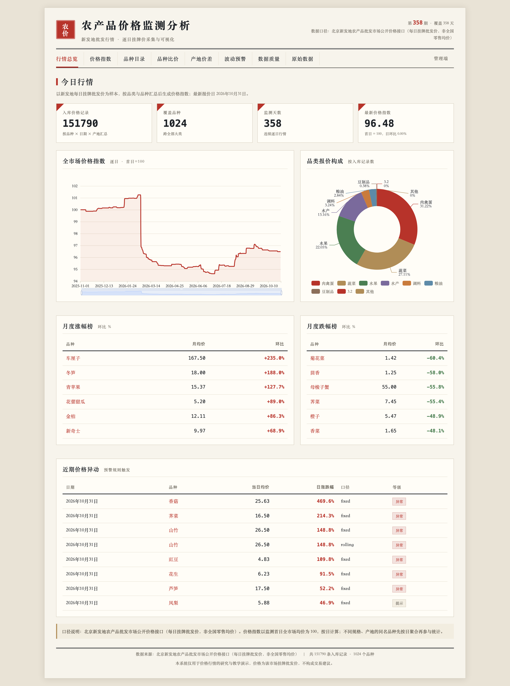
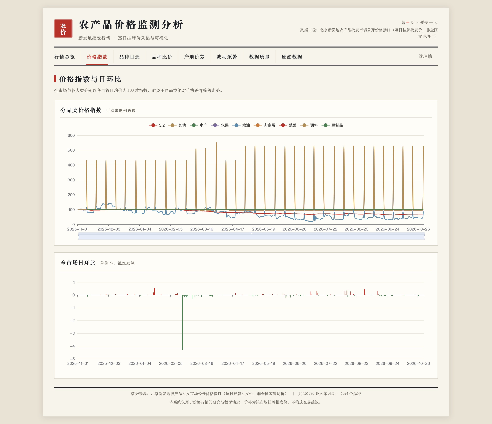
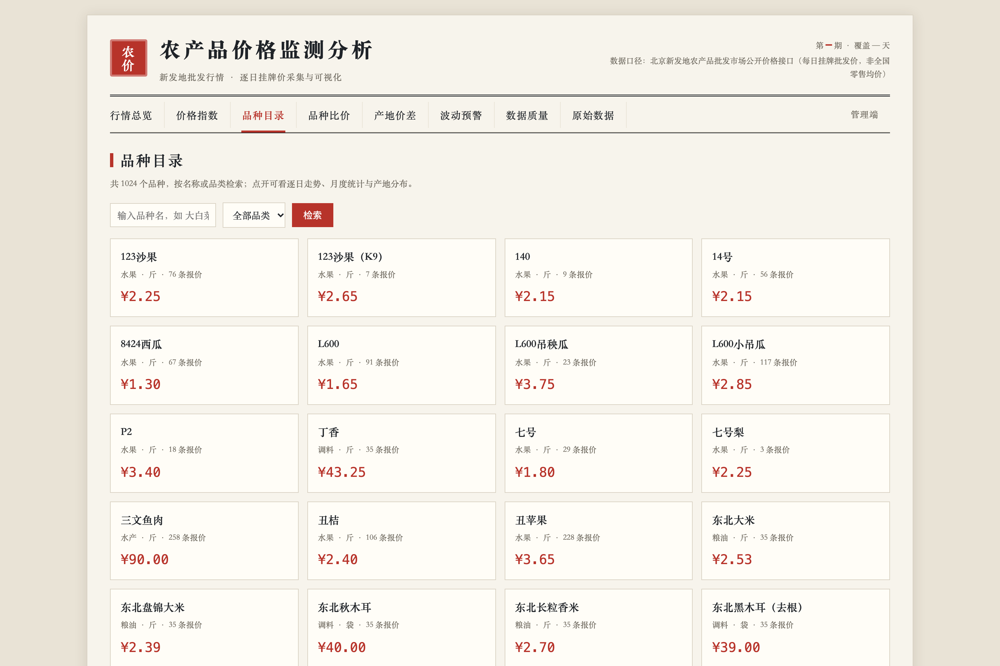
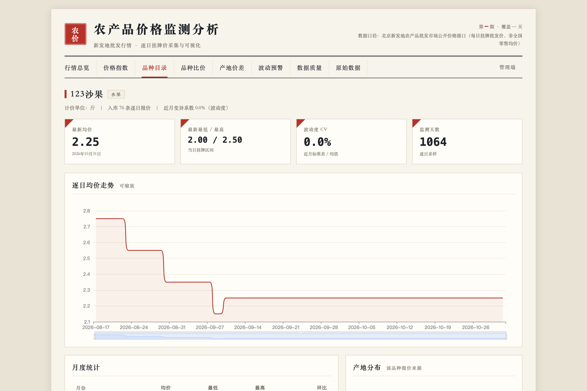
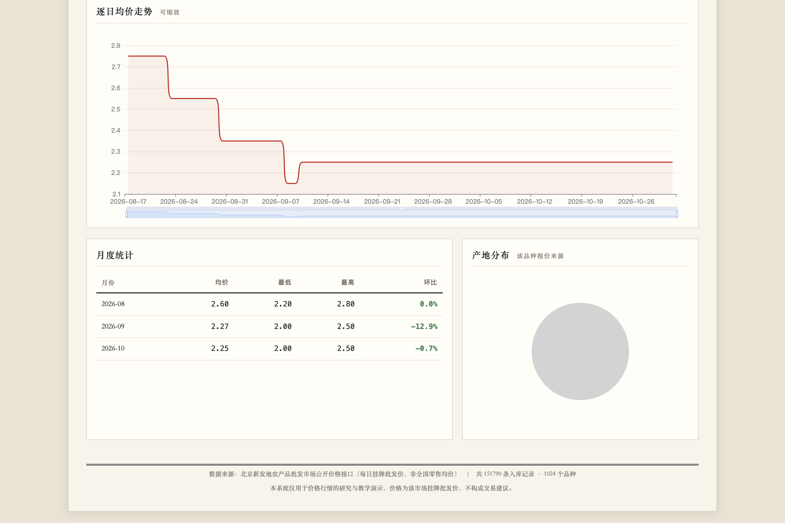
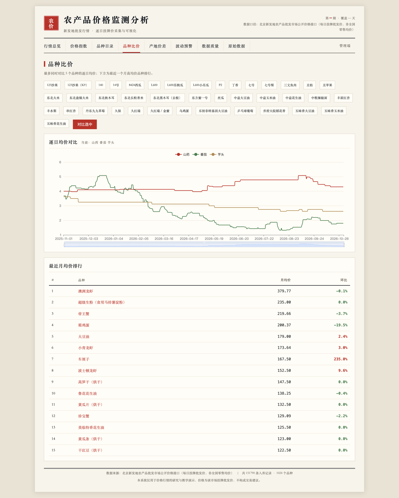
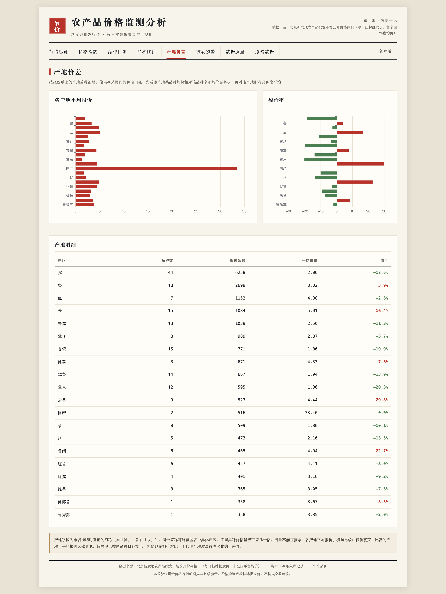
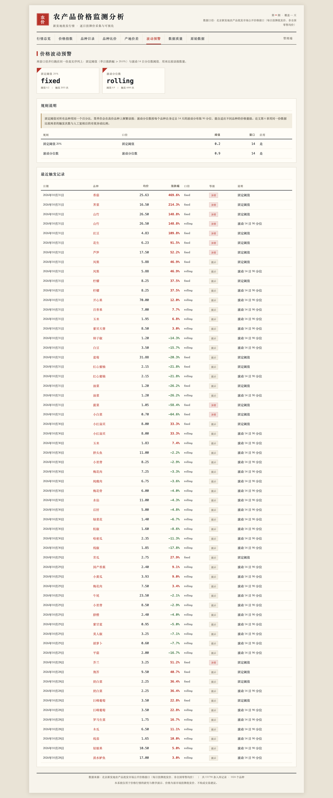
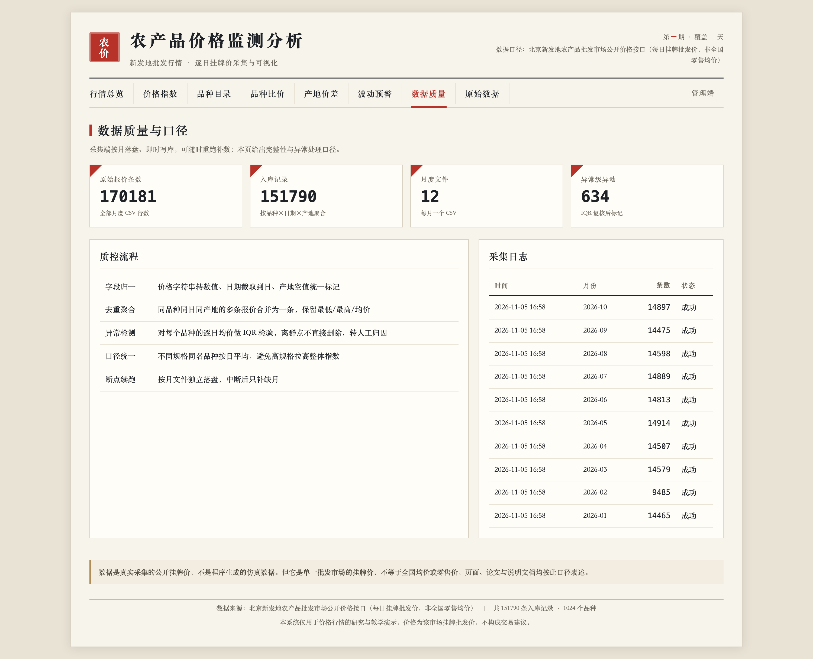
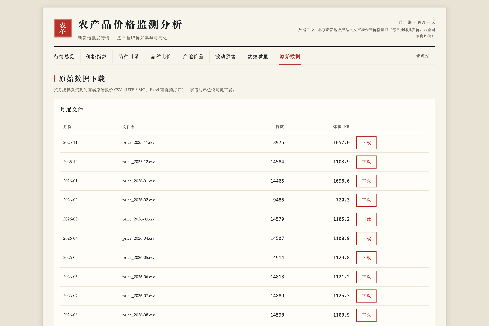
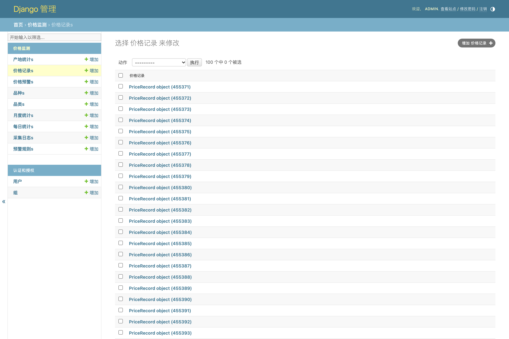
